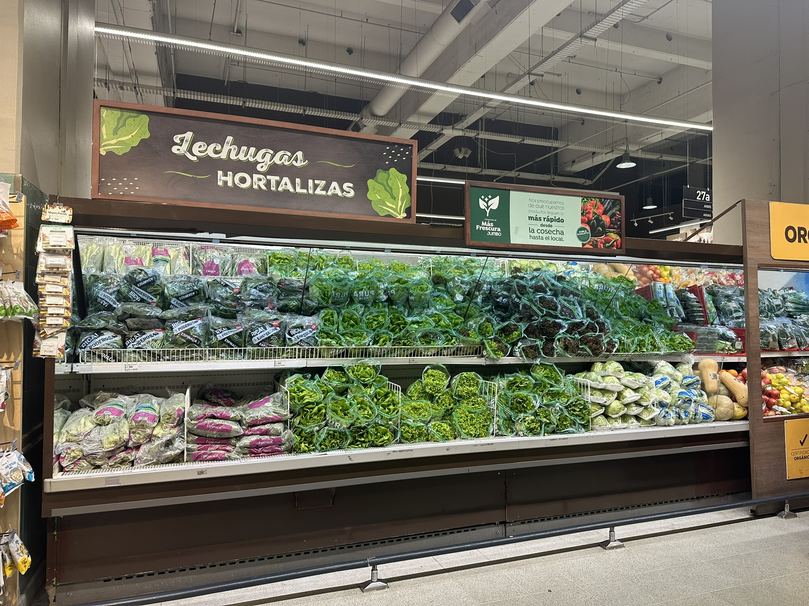
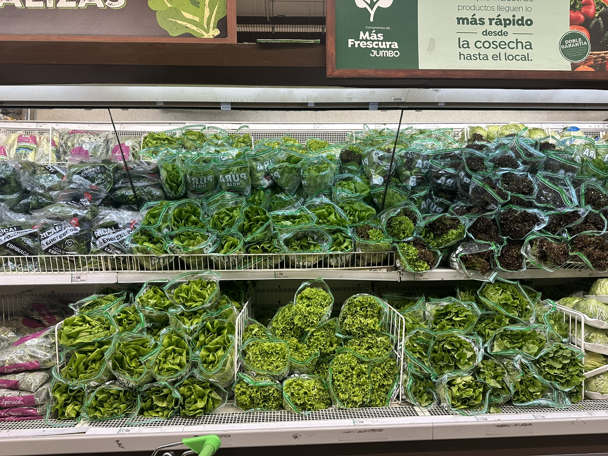
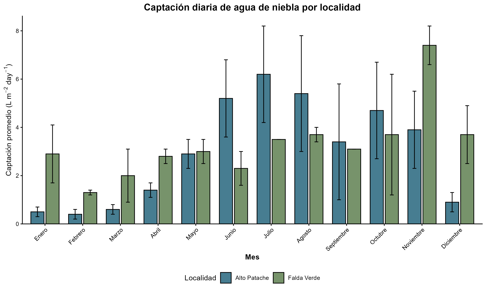

# wue-lettuce-atacama-desert
Repositorio del análisis exploratorio de datos (simulados) de ambientes de invernadero de bajo costo en la costa del desierto de Atacama para el aumento de la eficiencia del uso del agua de lechugas producidas hidropónicamente con agua de niebla.

> ## DISCLAIMER: este repositorio contiene datos que no son reales
> Los datos contenidos en los documentos que inician como "data-raw" fueron creados con inteligencia artificial para trabajar los contenidos del curso. 
>
> Los datos etiquetados como "data-bibliografia" fueron obtenidos de fuentes oficiales, tales como documentos gubernamentales o papers de investigación.
>
> Al final de esta sección se detalla el prompt ingresado en Chat GPT para la obtención de los datos.

## Resumen
El Desierto de Atacama, si bien es el lugar más árido del planeta, cuenta con un recurso que podría cambiar la agricultura de esta zona: la niebla costera. 

A partir de los resultados del proyecto Fondecyt 13220028 (2023-2025), donde se identificó la factibilidad de realizar cultivos hidropónicos con agua de niebla en Iquique y Chañaral, se propone estudiar cómo aumentar la eficiencia en el uso del agua para producir con este recurso en invernaderos localizados en la costa del Desierto de Atacama, donde confluyen condiciones de alta radiación y aridez. 

## ¿Por qué sería importante producir en el desierto?
Pongámonos en el siguiente escenario. 

Aprovechas una pequeña ventana de la universidad para ir a comprar una ensalada para tu almuerzo. Decides pasar desde el Campus San Joaquín al Jumbo, que está a dos estaciones de metro y te ofrece una gran variedad de dónde escoger. En el pasillo de las verduras ves una estantería repleta de lechugas, todas preciosas, pero una es notoriamente más pequeña que las demás e incluso se ve algo añeja. ¿Quién compraría esa lechuga, teniendo todas las demás disponibles? 

<p align="center">
  
  
</p>

Ahora te encuentras en Chañaral. No hay supermercado, por lo que para buscar tu lechuga debes ir la esquina donde "El Pino”, el caballero de las verduras, se para cada viernes junto a su camioneta con el pick-up abierto esperando a que escojas lo que quieres llevar de su selección. Ahora esa lechuga pequeña, notoriamente añeja y algo amarillenta es la mejor opción. El Pino te dice que es lo que quedó de su viaje a La Serena del lunes, después de haber vendido en Inca de Oro, Diego de Almagro y El Salado. Si quisieras otra cosa tendrías que ir al Unimarc que está en el pueblo vecino, Barquito, pero escuchaste que por un accidente en la ruta 5 no llegó la carga de la semana. 

Esta es la realidad de muchas localidades del Desierto de Atacama. Las condiciones de extrema aridez no permiten el florecimiento de una agricultura local que abastezca al 7% de la población de Chile que vive allí. Así, los alimentos deben viajar desde otras localidades, pasando largas horas arriba de un camión antes de arribar a los consumidores. La fragilidad del sistema queda reflejada en la alta inseguridad alimentaria que sufre esta zona, en promedio 20,5%, a pesar de albergar las regiones de mayores ingresos dedicadas a la producción de cobre. 

Pero existe una fuente de agua que no ha sido altamente considerada hasta el momento. El agua de niebla, o camanchaca, inunda por las noches la costa del desierto más árido del mundo, dejando tras su paso litros de agua que son posibles de capturar con el invento chileno donado a la UNESCO, el atrapanieblas. El proyecto Fondecyt 13220028, realizado entre 2023 y 2025, demostró que esta agua tiene condiciones de calidad aptas para la producción hidropónica. Gracias a este proyecto fue posible producir lechugas hidropónicas en invernaderos de bajo costo ubicados en dos localidades de la costa del Desierto de Atacama: Alto Patache, 70 km al sur de Iquique, y Falda Verde, Chañaral. Así, fue posible producir plantas con tan solo 3 L de agua por planta, cuando en producciones en suelo de la zona central esta cifra se mueve alrededor de los 100 L por planta.


<h2>Captación de agua de niebla</h2>

<p align="center">
  

  
</p>


Ahora tenemos una fuente de agua que, si bien no llevará a reemplazar el sistema actual, sí puede ayudar a complementarlo y así fortalecer la seguridad alimentaria de la zona. Pero seguimos estando en una zona de alta aridez, por lo que es necesario utilizarla con gran eficiencia. Entonces, ¿cuáles son las condiciones de producción que nos pueden llevar a maximizar la cantidad de kilos producidos por litro de agua? Eso es lo que busca dilucidar esta investigación. 

Se busca aumentar la eficiencia del uso del agua en producciones de lechugas hidropónicas de un invernadero localizado en la costa de Tarapacá mediante la manipulación de la temperatura, radiación y déficit de presión de vapor. A través de distintos ambientes de un invernadero de bajo costo, tanto en invierno como en verano, se evaluará qué condiciones ambientales son las que llevan a una mayor producción de kilos por litro de agua bajo las condiciones ambientales de extrema aridez del desierto de Atacama. 

## Preguntas exploratorias
1. ¿Qué ambiente permite producir la mayor cantidad de kilos por litro de agua en lechuga hidropónica, sin perder calidad comercial, a los 28 días después de trasplante?
2. El ambiente donde se produce la mayor eficiencia de agua gravimétrica a cosecha, ¿es el mismo donde se produce la mayor eficiencia del uso de agua fisiológica?
3. ¿Cómo se modifica la Eficiencia en el Uso del Agua en los distintos ambientes a medida que las lechugas crecen en el invernadero?

## Estructura del repositorio
```
wue-lettuce-atacama-desert
├── README.md
├── data/
│   └── data-raw/
      └── data-raw-hobo-inside.xlsx
      └── data-raw-hobo-outside.xlsx
      └── data-raw-lechugas.xlsx
      └── data-raw-mesas.xlsx
│   └── data-bibliografia/
      └── data-bibliografia-inseguridad-alimentaria.xlsx
      └── data-bibliografia-niebla.xlsx
      └── data-bibliografia-pib-sap.xlsx
      └── data-bibliografia-precipitaciones.xlsx
├── scripts/
    ├── 01-grafico-niebla.R
    ├── 02-grafico-niebla-comparativo.R
    └── 03-grafico-curva-crecimiento-lechugas.R
└── plot/
    ├── 01-grafico-niebla.png
    ├── 02-grafico-niebla-comparativo.png
    └── 03-curva-crecimiento-lechugas.png
└── manuscrito/
    ├── 01-grafico-niebla.pdf
    ├── 02-grafico-niebla-comparativo.pdf
    └── 03-curva-crecimiento-lechugas.pdf
```


## Bibliografía
- Albornoz, F.; del Río, C.; Carter, V.; Escobar, R.; Vásquez, L. Fog Water Collection for Local Greenhouse Vegetable Production in the Atacama Desert. Sustainability 2023, 15, 15720. https://doi.org/10.3390/su152215720
- DGAC (2026). Anuario Meteorológico 2025. Dirección Meteorológica de Chile, Subdepto. Climatología y Met. Aplicada, Sección Climatología. https://climatologia.meteochile.gob.cl/publicaciones/anuario/anuario-2025.pdf 
- ODEPA. (2026). Ficha regional: Región de Tarapacá. www.odepa.gob.cl
- Yáñez, R., Navea, J., & Jara, B. (2023). Inseguridad alimentaria en Chile: una perspectiva multidimensional. https://rimisp.org/inseguridad-alimentaria-en-chile-una-perspectiva-multidimensional/

## Prompt Chat GPT
Para mi análisis de Eficiencia en el Uso del Agua, necesitaba los siguientes datos:
- Producción de lechuga (data-raw-lechugas).
- Consumo de agua de las lechugas (data-raw-mesas).
- Datos ambientales de invernadero (data-raw-hobo-inside y data-raw-hobo-outside)

### data-raw-lechugas
Como base, partí con una planilla excel donde yo asigné las columnas y la base de los datos de identificación:

| Nombre columna | Significado | Valores |
|---|---|---|
| # | ID de cada entrada, en número | 1-1792 |
| ID | ID de cada entrada, en letras | a-bpx |
| pool | Número de la piscina de producción | 1-8 |
| season | Temporada de producción | invierno y verano |
| treatment | Tratamiento ambiental del invernadero | 1 y 2 |
| rep | Repetición por tratamiento y temporada | 1 y 2 |
| date-dat | Día después de trasplante | 1-28 |
| date-week | Semana de producción | 1-4 |
| date-calendar | Fecha del calendario | Desde 1 mayo 2026 a 28 febrero 2027 |
| lettuce-number-id | ID para cada lechuga. Indica season-pool.datedat-treatment-rep |  Ej: inv-1.1-T1R1|
| fresh-weight_root_g | Peso fresco raíz | Indicado en el prompt |
| dry-weight_root_g | Peso seco raíz | Indicado en el prompt |
| fresh-weight_leaves_g | Peso fresco hojas | Indicado en el prompt |
| dry-weight_leaves_g | Peso seco hojas | Indicado en el prompt |
| leaf-area_leaves_cm2 | Área de las hojas | Indicado en el prompt |
| A_leaves_umol-m2-s1 | Fotosíntesis neta (umol Co2 m-2 s-1) | Indicado en el prompt |
| E_leaves_umol-m2-s1 | Transpiración (umol H20 m-2 s-1) | Indicado en el prompt |
| gs_leaves_umol-m2-s1 | Conductancia estomática (umol H2O m-2 s-1) | Indicado en el prompt |

**Para los datos "Indicado en el prompt", esto fue lo indicado a Chat GPT:**

*Necesito que puedas crear datos ficticios en una planilla Excel. Para crear los datos del treatment 1, toma de referencia este Excel y en la hoja "lettuce" necesito que hagas lo siguiente:*

*-Para la **columna "ID"**, completa las letras correspondientes para el total de entrada de datos.*

*-Rellena los datos de peso fresco, peso seco, área foliar, A, E, gs en base a lo siguiente:*

   *-Los datos están agrupados para las piscinas o "pool" de la 1 a la 8. Cada piscina tiene 28 datos, 1 por cada día calendario. El orden de los datos va desde la piscina 1, temporada invierno, tratamiento 1 y repetición 1 con sus 28 días para luego seguir con las piscinas desde la 2 a la 8. Posteriormente, sigue con la temporada invierno, tratamiento 1 y repetición 2, luego tratamiento 2, repetición 1 y tratamiento 2 rep 2; luego temporada verano, tratamiento 1, repetición 1, temporada verano, tratamiento 1, repetición 2, temporada verano, tratamiento 2, rep 1 y finalmente temporada verano, tratamiento 2, rep 2.*
   
  *-Para rellenar la columna de **fresh-weight_leaves_g**, este valor va progresivamente aumentando desde el día 1 hasta el 28. El mínimo valor que podemos obtener de las lechugas en el día 1 va en 15,02 g y el máximo en el día 28 llega a 158,89 g en invierno y 236,68 en verano.*
  
*-Para rellenar la columna de **dry-weight_leaves_g**, este valor va progresivamente aumentando desde el día 1 hasta el 28. El mínimo valor que podemos obtener de las lechugas en el día 1 va en 0,71 g y el máximo en el día 28 llega a 7,13 g en invierno y 10,29 en verano.*

  *-Para rellenar la columna de **leaf-area_leaves_cm2**, este valor va progresivamente aumentando desde el día 1 hasta el 28. El mínimo valor que podemos obtener de las lechugas en el día 1 va en 0,08 g y el máximo en el día 28 llega a 210,34 g en invierno y 245,81 en verano.*

*Luego, agrega los datos para:*

*-**fresh-weight_root_g**: el valor mínimo es 2,34 en invierno y 3,98 en verano; el valor máximo es 20,6 en invierno y 25,89 en verano.*

*-**dry-weight_root_g**: el valor mínimo es 0,08 en invierno y 0,16 en verano; el valor máximo es 0,9 en invierno y 1,22 en verano.*

*-Los valores de **A, E y gs** por favor asignalos tú según valores típicos de crecimiento para lechuga, considerando, además de la diferencia entre tratamientos, que en invierno los valores sean menores que en verano.*

*Necesito que crees los datos para el tratamiento 2 considerando los valores que ya existen para el tratamiento 1, pero ahora con que existan diferencias entre el T1 y el T2 de entre un 25 y un 40%, obteniendo mayores diferencias en verano. Considera que T2>T1*

### data-raw-mesas
La base de los datos identificatorios siguió la misma lógica de la planilla data-raw-lechugas, solo con nuevos datos que eran exclusivos para el agua. 

| Nombre columna | Significado | Valores |
|---|---|---|
| # | ID de cada entrada, en número | 1-1792 |
| ID | ID de cada entrada, en letras | a-bpx |
| pool | Número de la piscina de producción | 1-8 |
| season | Temporada de producción | invierno y verano |
| treatment | Tratamiento ambiental del invernadero | 1 y 2 |
| rep | Repetición por tratamiento y temporada | 1 y 2 |
| date-dat | Día después de trasplante | 1-28 |
| date-week | Semana de producción | 1-4 |
| date-calendar | Fecha del calendario | Desde 1 mayo 2026 a 28 febrero 2027 |
| total-plants_pool_n | Total de lechugas disponibles en la mesa para cada fecha | 42-15|
| ns-volume_pool_l | Volumen de agua disponible en la mesa | Indicado en el prompt |
| ph_pool_no-unit | pH de la solución nutritiva | Indicado en el prompt |
| ce_pool_ds-m | Conductividad eléctrica de la solución nutritiva | Indicado en el prompt |

- Se debe considerar que se asumió que por cada día se cosechaba una lechuga de cada mesa, por lo que se agregó la columna "total-plants_pool_n" que identifica cuántas lechugas van quedando con el paso de los días. Cada mesa iniciaba con 42 lechugas y luego de 28 días de producción terminaba con 15 plantas.

- Para **ns-volume_pool_l** se consideró que se partía con un volumen inicial de agua el que va disminuyendo con el paso de los días y no hay rellenos entremedio de la producción, solo al inicio de cada ciclo.

**Para los datos "Indicado en el prompt", esto fue lo indicado a Chat GPT:**

*Para la hoja "water" necesito que crees los siguientes datos para estas columnas:*

*-Columna **ns-volume_pool_l**:*

  *-El consumo de agua debe aumentar progresivamente desde el día 1 hasta el día 28, siguiendo el crecimiento de las lechugas indicado en la hoja "lettuce", creada anteriormente.*
  
  *-Los valores deben presentar variabilidad diaria y entre piscinas, evitando patrones perfectamente lineales.*

  *-El consumo de agua debe ser mayor durante el verano que durante el invierno, debido a las mayores demandas evaporativas.*

  *-El día date-dat 1 debe partir con valores alrededor de 150, mientras que el día date-dat 28 debe terminar con valores alrededor de 28. Considera dos decimales.*

***Diferencias entre tratamientos:***

*-Considera diferencias en el consumo de agua entre T1 y T2.*

*-Los valores deben ser coherentes con las diferencias de crecimiento y biomasa existentes entre ambos tratamientos.*

*-Las diferencias deben considerar las condiciones de cada temporada.*

*-El consumo acumulado de agua debe aumentar durante todo el período de crecimiento.*

*-Debe existir variabilidad entre piscinas y repeticiones.*

*Como resultado, entrega una nueva planilla Excel con los datos completos de consumo diario de agua, manteniendo la estructura original.*


### data-raw-hobo-inside y data-raw-hobo-outside

Como base, las columnas de la planilla excel son las siguientes (los datos cambiaron a hobo_in o hobo_out dependiendo de si los datos meteorológicos son medidos dentro o fuera del invernadero):

| Nombre columna | Significado | Valores |
|---|---|---|
| N° | ID de cada entrada, en número | 1-43776 |
| fecha_hobo-in_iso| Fecha de cada dato | Desde mayo 2026 a febrero 2027 |
| tiempo_hobo-in_hora | Hora de cada dato | Datos cada 10 minutos |
| radiacion_hobo-in_umol-m2-s1 | Dato de sensor de radiación PAR | Indicado en el prompt |
| temperatura_hobo-in_C | Dato de sensor de temperatura | Indicado en el prompt |
| hr_hobo-in_%  | Dato de sensor de humedad relativa | Indicado en el prompt |

**Para los datos "Indicado en el prompt", esto fue lo indicado a Chat GPT:**

*Tomando como referencia este Excel, necesito que generes datos ambientales ficticios para las hojas "envir-inside" y "envir-outside", considerando lo siguiente:*


***1. Organización de los datos***

*-Los registros deben generarse cada 10 minutos.*

*-Fecha de inicio: 1-may-26.*

*-Fecha de término: 28-feb-27.*

*-Mantén el formato de fecha 2026-05-01.*

*-Las mediciones deben cubrir las 24 horas del día.*


***2. Datos ambientales dentro del invernadero (envir-inside)***


***Radiación solar:***

*-Durante la noche, la radiación debe mantenerse en 1,2 µmol m⁻² s⁻¹.*

*-En invierno, considera horario nocturno entre las 18:00 y las 09:00.*

*-En verano, considera horario nocturno entre las 19:40 y las 08:00.*

*-Durante el día, la radiación debe aumentar progresivamente durante la mañana, alcanzar sus valores máximos alrededor del mediodía y disminuir durante la tarde.*

*-Los valores deben presentar diferencias estacionales, con mayor radiación en verano que en invierno.*

*-Incorpora fluctuaciones naturales asociadas a nubosidad y eventos de niebla.*


***Temperatura:***

*-Genera variaciones diarias y estacionales coherentes con las condiciones de un invernadero ubicado en Iquique.*

*-La temperatura debe aumentar durante la mañana, alcanzar valores máximos durante la tarde y disminuir durante la noche.*

*-Considera temperaturas generalmente mayores en verano que en invierno.*

*-Evita patrones perfectamente repetitivos entre días.*


***Humedad relativa***

*-Los valores deben mantenerse entre 35,8 y 99,99%.*

*-La humedad relativa debe presentar una relación generalmente inversa con la temperatura.*

*-Considera mayores valores durante la noche y madrugada.*

*-Incorpora eventos de niebla o nubosidad costera, durante los cuales la humedad relativa puede aproximarse al 99,99%.*


***3. Datos ambientales fuera del invernadero (envir-outside)***

*-Los datos exteriores deben estar relacionados con los registros interiores, manteniendo coherencia temporal entre ambas hojas.*


***Radiación solar***

*-Durante la noche, la radiación debe mantenerse en 0,6 µmol m⁻² s⁻¹.*

*-El valor máximo permitido es 1236,8 µmol m⁻² s⁻¹.*

*-Considera variaciones diarias y estacionales.*

*-Incorpora reducciones de radiación asociadas a nubosidad y niebla.*


***Temperatura***

*-Los valores deben representar condiciones ambientales exteriores de Iquique.*

*-Mantén una variación diaria coherente con los ciclos de radiación solar.*

*-Considera las diferencias de temperatura entre el interior y el exterior del invernadero.*


***Humedad relativa***

*-Los valores deben mantenerse entre 31,8 y 99,99%.*

*-Durante los eventos de niebla, la humedad relativa debe alcanzar exactamente 99,99%.*

*-Considera valores generalmente mayores durante la noche y madrugada.*


***4. Coherencia de los datos***

*-Los datos deben representar condiciones ambientales plausibles de una zona costera árida.*

*-Debe existir variabilidad entre días, semanas y meses.*

*-Evita curvas perfectamente simétricas o patrones artificialmente repetitivos.*

*-Los eventos de niebla deben afectar de manera coherente la radiación solar, la temperatura y la humedad relativa.*

*-Los registros interiores y exteriores deben corresponder a las mismas fechas y horas.*


***5. Entrega de los datos***

*Debido al gran número de registros, genera una planilla Excel por mes, comenzando con mayo de 2026 y terminando con febrero de 2027.*

*Cada planilla debe contener las hojas correspondientes a los datos interiores y exteriores, conservando los encabezados establecidos y la numeración consecutiva de los registros entre meses.*
